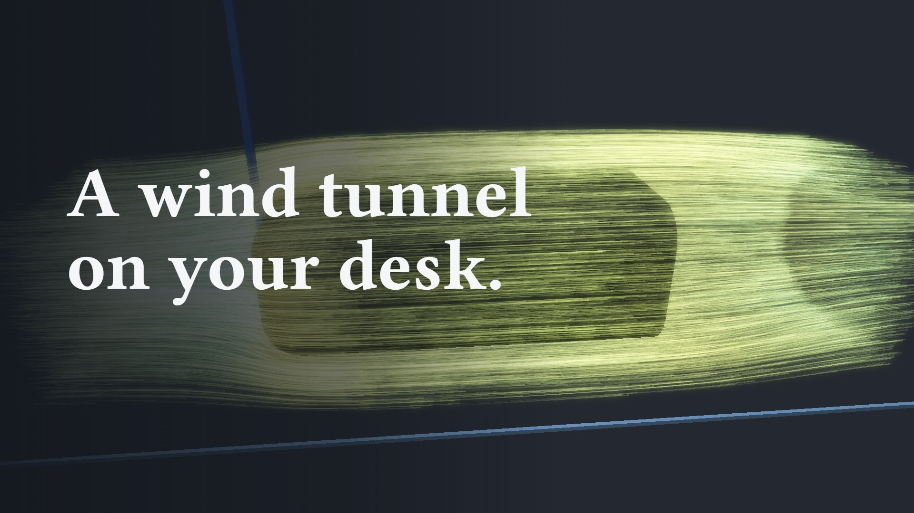
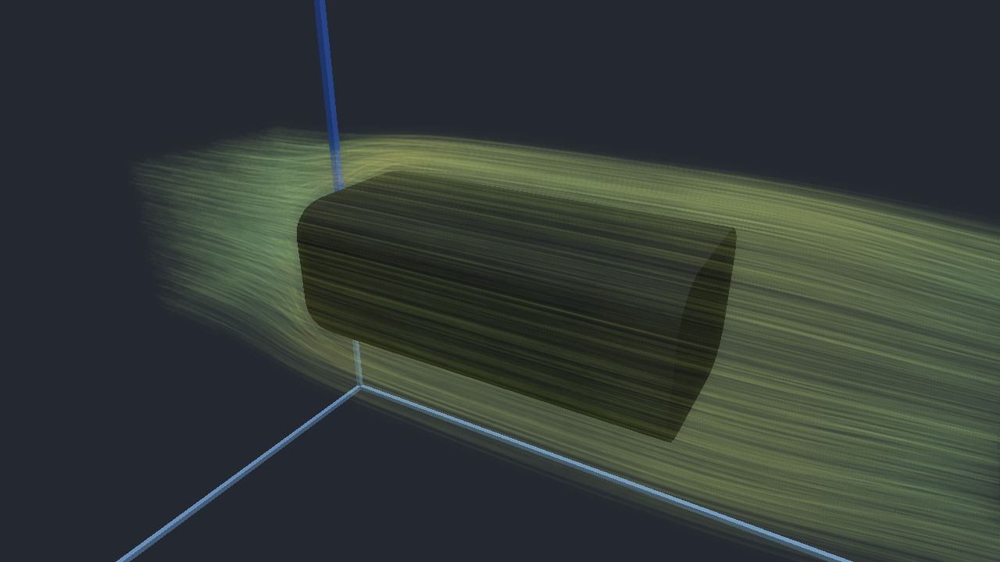
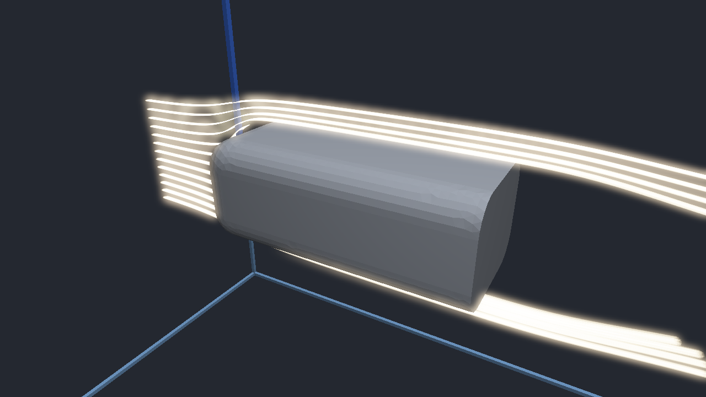
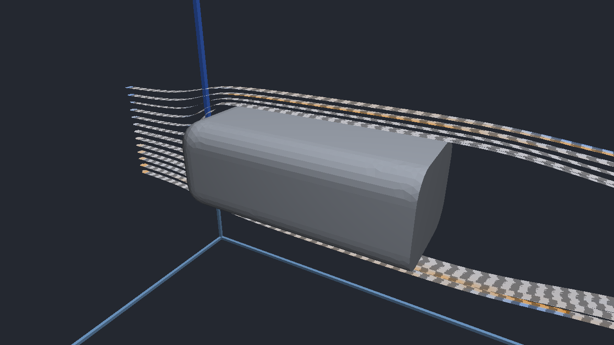
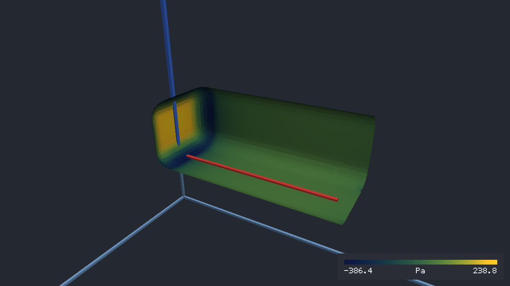
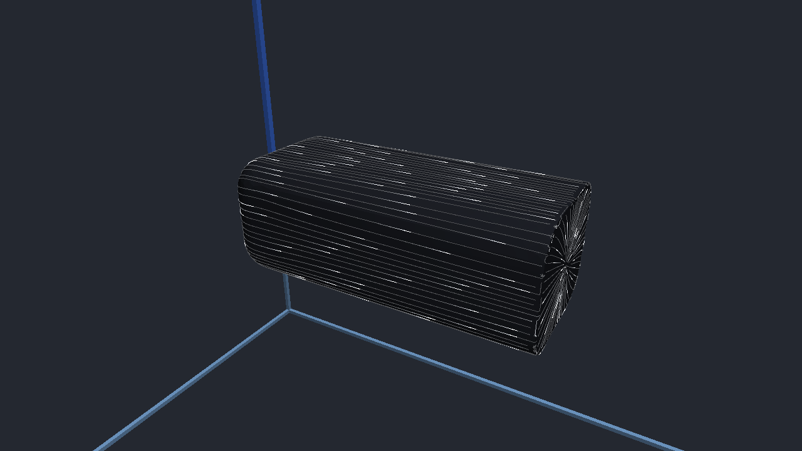
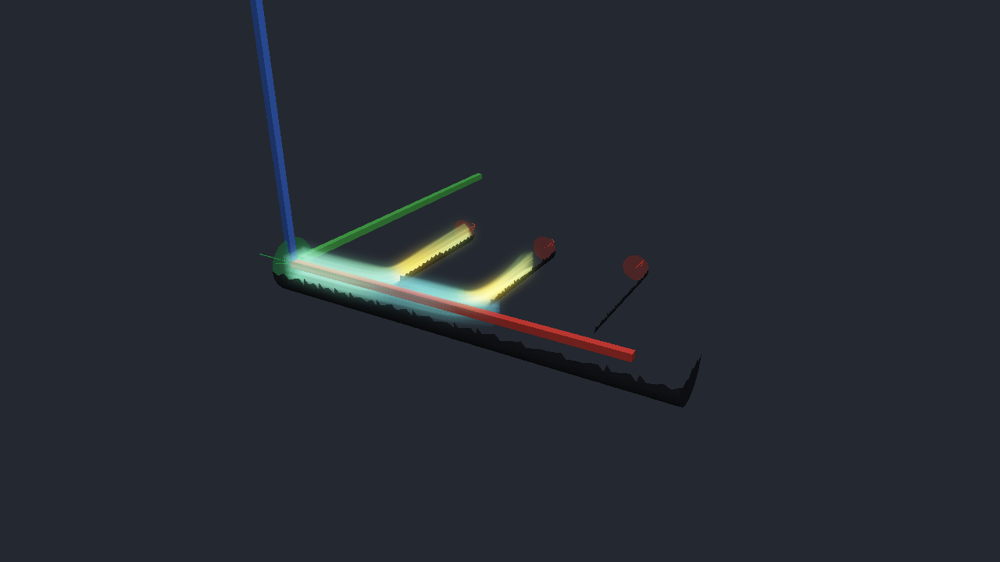
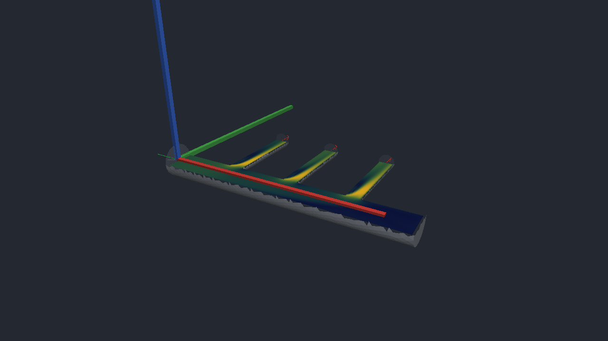

# FoamCraft

FoamCraft is a free, open-source desktop app that makes CFD simulation with OpenFOAM approachable
for people who are not simulation experts. Load a 3D model, put it into a virtual wind tunnel or
click where the flow enters and leaves a part, press **Run**, and then explore the result: smoke
lines, glowing particle trails, ribbons that twist with the swirl, pressure on the surface, a ride
along a single particle, and exported images, videos and reports.

[](https://sphaerox.github.io/FoamCraft/#demo)

**[Website and demo video](https://sphaerox.github.io/FoamCraft/)** (the video file:
[site/media/demo.mp4](site/media/demo.mp4))

> **Status:** in active development, no installer yet. You can build and run it from source (see
> below). The pictures on this page are rendered automatically from the sample projects by a
> GitHub workflow, so they always show the current state of the code.



## What it does

- **Geometry:** import STL, OBJ, 3MF, STEP and IGES; check that the model is closed, move, rotate
  and place it with handles in the 3D view.
- **Two kinds of flow:** a virtual wind tunnel around a model (speed, wind direction, ground) and
  internal flow through a part (click a face to make it an inlet or outlet; openings can be
  capped); several scenarios per project and a queue that runs them one after another.
- **Automatic set-up:** meshing, solver settings and convergence detection are chosen for you, with
  a quality setting from draft to fine and a hardware check that sizes the run to your computer.
- **Key figures with explanations:** drag and lift coefficients, forces, drag area, power,
  pressure loss and flow per opening, each explained in plain words, plus a reliability light
  that says how far the numbers can be trusted and why.
- **Seeing the flow:** GPU-rendered 3D view with slices, iso-surfaces, a clip plane, smoke lines,
  comets and light trails (with long exposure), ribbons and tubes, oil-film lines and wool tufts
  on the surface, and heavy particles such as rain or sand with an impact map.
- **Ride along:** follow one particle in first-person, chase or overview camera, with live
  readings (speed, pressure, distance to the wall) and events such as stagnation or separation.
- **Ready-made views:** a gallery of presets and a demo that walks through them.
- **Export:** PNG up to 8K (also with a transparent background or as a long exposure), videos with
  camera paths, and a PDF/HTML report that can compare two runs.
- **For AI agents:** an MCP server (`foamcraft mcp`) gives agents the same commands as the
  interface: set up a project, run it, read the figures and get pictures of the 3D view. See
  [docs/mcp.md](docs/mcp.md).
- **English and German** interface. Everything runs locally: no account, no telemetry.

## Pictures

All pictures come from the two sample projects that ship with FoamCraft (draft quality).

|                                                                                               |                                                                                        |
| --------------------------------------------------------------------------------------------- | -------------------------------------------------------------------------------------- |
|  |  |
| Smoke lines from a rake (long exposure)                                                       | Ribbons that twist with the swirl                                                      |
|              |            |
| Pressure on the model                                                                         | Oil-film lines show where the flow separates                                           |
|          |           |
| Light trails through a pipe manifold                                                          | Speed on a slice through the manifold                                                  |

## Building from source

Requirements:

- [Rust](https://rustup.rs) (the toolchain version is pinned in `rust-toolchain.toml` and installed
  by rustup on the first build)
- Node.js 22 or newer with npm
- [Docker](https://www.docker.com/) (Docker Desktop on Windows and macOS): OpenFOAM runs in a
  container image that FoamCraft builds from `runtime/`
- A GPU with Vulkan, DirectX 12 or Metal support for the 3D view
- The [Tauri prerequisites](https://v2.tauri.app/start/prerequisites/) of your platform

```bash
npm ci                          # JS tooling and frontend dependencies
npm run app:dev                 # start the desktop app in development mode
cargo build --release -p foamcraft-cli
target/release/foamcraft runtime build   # build the OpenFOAM runtime image (once)
```

On the first start the setup assistant checks Docker, memory and the runtime image and helps with
anything that is missing. Windows is the main platform; Linux and macOS are supported.

### Command line

The `foamcraft` CLI offers every command of the app:

```bash
foamcraft command list                          # all commands
foamcraft command describe export.image         # parameters of one command
foamcraft command batch --project <folder> '[{"name": "run.start", "params": {"wait": true}}]'
foamcraft mcp --root <folder>                   # MCP server for AI agents
```

### Tests

```bash
cargo test --workspace    # Rust tests (core, simulation, renderer with golden images, API)
npm test                  # frontend tests (Vitest)
npm run lint
```

Development follows strict test-driven development; see [AGENTS.md](AGENTS.md) and
[docs/testing.md](docs/testing.md).

## Project layout

| Folder                                         | Content                                                          |
| ---------------------------------------------- | ---------------------------------------------------------------- |
| `crates/foamcraft-core`                        | projects, the command API, errors and their explanations         |
| `crates/foamcraft-sim`                         | meshing plans, solver set-up, results, particles, rides, ribbons |
| `crates/foamcraft-render`                      | the wgpu renderer (3D view, particles, light trails, exports)    |
| `crates/foamcraft-api`                         | all commands used by the app, the CLI and the MCP server         |
| `crates/foamcraft-cli`, `crates/foamcraft-mcp` | command line and MCP server                                      |
| `app/`                                         | Tauri 2 shell with a React and TypeScript interface              |
| `runtime/`                                     | the OpenFOAM container image                                     |
| `samples/`                                     | sample projects (CC0)                                            |
| `site/`                                        | the website (GitHub Pages) and the demo video                    |
| `docs/`                                        | architecture, testing, code style, conventions, licensing        |
| `Roadmap/`                                     | the work plan (in German)                                        |

## Screenshots workflow

[`.github/workflows/screenshots.yml`](.github/workflows/screenshots.yml) builds the CLI and the
runtime image on a Linux runner, runs both samples and renders the pictures with
[`tools/screenshots/make-screenshots.sh`](tools/screenshots/make-screenshots.sh) (software Vulkan
driver, no GPU needed). Changed pictures are committed to `docs/screenshots/`. Run it by hand
from the Actions tab, or locally with the same script.

[`.github/workflows/pages.yml`](.github/workflows/pages.yml) publishes the website from `site/`
with the same pictures ([`tools/site/assemble.sh`](tools/site/assemble.sh)) whenever the page or
the pictures change.

## License

FoamCraft is licensed under the [GNU General Public License v3.0 or later](LICENSE). Dependency
and asset rules are in [docs/licensing.md](docs/licensing.md). The sample projects are CC0.

## Trademark notice

FoamCraft is an independent project. This offering is not approved or endorsed by OpenCFD Limited,
producer and distributor of the OpenFOAM software via www.openfoam.com, and owner of the OPENFOAM®
and OpenCFD® trade marks.

## Disclaimer

Simulation results are estimates. They are not certified and come without any warranty; do not use
them as the sole basis for safety-relevant decisions.
